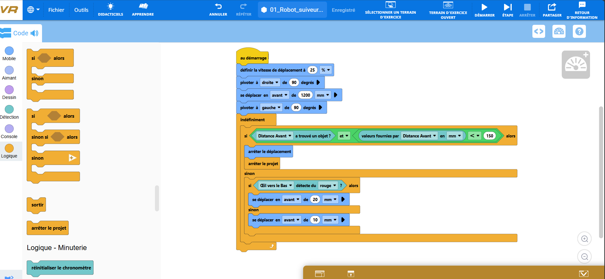
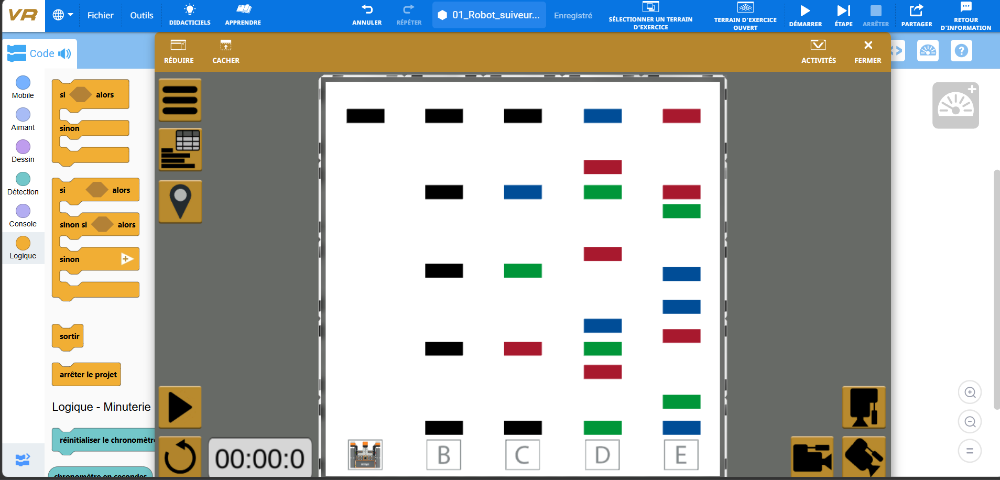
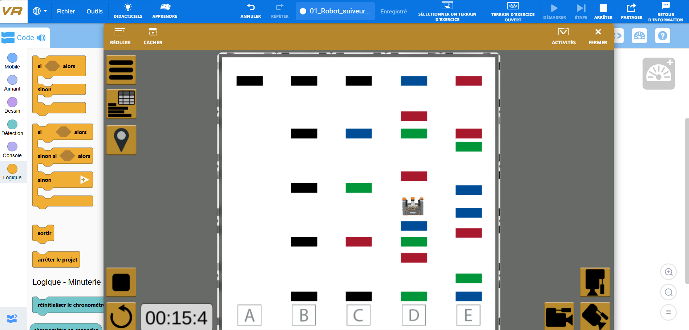
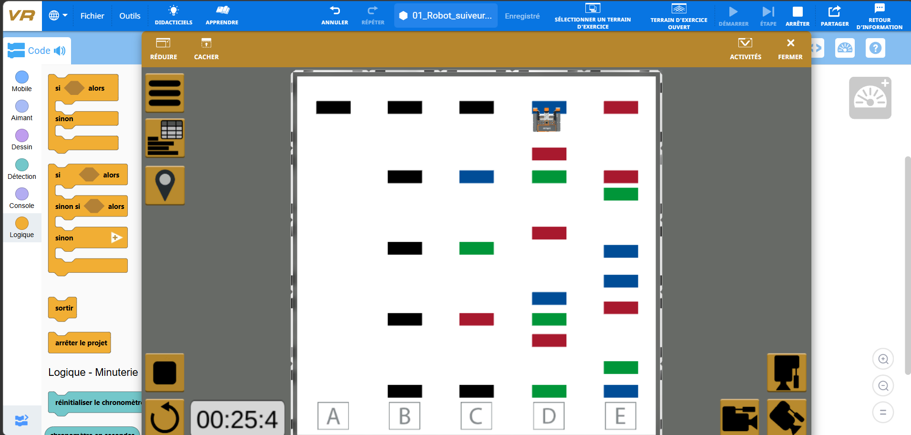

# Projet 1 — Robot suiveur de ligne

## 1. Présentation du projet

Ce projet a été réalisé dans le cadre du cours de Robotique et Intelligence Artificielle.

Il consiste à programmer un robot virtuel capable de se déplacer sur un terrain comportant plusieurs lignes colorées, en utilisant les capteurs intégrés au robot.

La simulation a été réalisée sur la plateforme VEXcode VR, qui permet de programmer et de tester les déplacements d'un robot dans un environnement virtuel.

Pour cette réalisation, nous avons choisi de faire suivre au robot un parcours correspondant à la colonne D du terrain Grid Map.

## 2. Objectif du projet

L'objectif principal est de programmer un robot capable de suivre une ligne colorée en utilisant les informations fournies par ses capteurs.

Plus précisément, le projet vise à :

- Programmer les déplacements du robot à l'aide de blocs.
- Utiliser un capteur optique pour identifier une couleur au sol.
- Exploiter les structures conditionnelles pour adapter les déplacements.
- Utiliser une boucle pour répéter les instructions.
- Détecter un obstacle situé devant le robot.
- Arrêter automatiquement le programme lorsqu'une condition de détection est remplie.

## 3. Outils et composants utilisés

### Environnement de programmation

- **VEXcode VR :** plateforme de programmation et de simulation robotique.
- **Grid Map :** terrain virtuel constitué de plusieurs colonnes et de lignes colorées.
- **Programmation par blocs :** méthode de programmation visuelle utilisée pour définir les actions du robot.

### Composants virtuels

- **Robot VEX VR :** robot mobile chargé d'exécuter les déplacements.
- **Capteur optique (Down Eye) :** permet de détecter les couleurs présentes sous le robot.
- **Capteur de distance (Front Distance) :** permet de détecter la présence d'un obstacle devant le robot.
- **Système de déplacement :** permet au robot d'avancer et de pivoter.

## 4. Fonctionnement du projet

### Étape 1 — Programmation du robot

Le programme a été développé à l'aide des blocs disponibles dans VEXcode VR.

Les premières instructions permettent de définir la vitesse de déplacement du robot et de lui faire effectuer les mouvements nécessaires pour rejoindre la colonne D.

Une fois cette position atteinte, une boucle `indéfiniment` permet de répéter les instructions de contrôle.

Le programme utilise ensuite des conditions pour analyser les informations provenant des capteurs.

Le capteur optique intervient dans le suivi de la ligne colorée, tandis que le capteur de distance permet de vérifier la présence d'un obstacle devant le robot.

Une instruction d'arrêt du projet a également été intégrée pour éviter que le robot continue à avancer lorsqu'il rencontre un obstacle.

**Capture du programme :**

### Étape 2 — Position initiale du robot

Au lancement de la simulation, le robot se trouve dans sa position initiale, près de la colonne A du terrain.

Le programme commence par exécuter les instructions de déplacement définies pour rejoindre la zone de suivi.

**Capture de la position initiale :**

### Étape 3 — Déplacement vers la colonne D

Le robot effectue les mouvements programmés afin de rejoindre la colonne D.

Cette étape permet de vérifier que les instructions de déplacement et de rotation sont correctement exécutées.

Une fois arrivé dans cette zone, le robot commence à suivre le parcours défini.

**Capture du robot sur la colonne D :**

### Étape 4 — Suivi de la ligne colorée

Le robot poursuit son déplacement le long de la colonne D.

Le programme utilise une condition basée sur la détection d'une couleur par le capteur optique.

Lorsque la condition est remplie, le robot avance selon la distance programmée.

Dans le cas contraire, d'autres instructions permettent de modifier son déplacement.

L'utilisation de la boucle permet de répéter cette vérification pendant la progression du robot.

**Capture du suivi de ligne :**

### Étape 5 — Progression et arrêt automatique

Au cours de la simulation, le robot progresse le long de la colonne D jusqu'à atteindre l'extrémité du terrain.

Lors des premiers essais, le robot continuait à avancer et pouvait rester bloqué contre le mur.

Pour résoudre ce problème, nous avons ajouté une condition utilisant le capteur de distance.

Lorsque ce capteur détecte un obstacle à la distance définie dans le programme, les instructions d'arrêt sont exécutées.

Cette modification permet d'éviter que le robot continue à avancer contre le mur.

**Capture de la progression du robot :**

## 5. Résultats obtenus

Les simulations réalisées ont permis d'obtenir les résultats suivants :

- Le robot démarre depuis sa position initiale.
- Il rejoint la colonne D du terrain.
- Il progresse le long de cette colonne en exécutant les instructions programmées.
- Le programme utilise le capteur optique pour prendre en compte une couleur détectée au sol.
- Le capteur de distance permet de détecter un obstacle devant le robot.
- Le programme s'arrête automatiquement lorsqu'il atteint la condition d'arrêt.

Les premiers essais ont également permis d'identifier certaines difficultés, notamment des rotations répétitives et le blocage du robot contre le mur.

Plusieurs ajustements ont été effectués sur les instructions de déplacement et les conditions de détection afin d'améliorer son comportement.

Le résultat final correspond à un robot capable de suivre le parcours choisi sur la colonne D et de s'arrêter automatiquement à l'extrémité du terrain.

## 6. Limites du projet

Le programme a été adapté au parcours choisi sur la colonne D.

Il ne permet pas encore de suivre automatiquement toutes les lignes du terrain ni de choisir un nouveau parcours de manière autonome.

Une amélioration possible serait de développer un système de suivi de ligne plus général, capable de gérer plusieurs couleurs, les changements de direction et différents parcours.

## 7. Conclusion

Ce projet nous a permis de mettre en pratique plusieurs notions fondamentales de la programmation robotique, notamment le contrôle des déplacements, les structures conditionnelles, les boucles et l'utilisation des capteurs.

Les différentes simulations ont montré l'importance de tester progressivement un programme afin d'identifier les erreurs et d'améliorer le comportement du robot.

La réalisation a également permis de comprendre comment les informations provenant des capteurs peuvent être utilisées pour adapter les actions d'un robot dans un environnement virtuel.

## 8. Fichiers du projet

- `01_Robot_suiveur_ligne.vrblocks` : programme réalisé sur VEXcode VR.
- `captures/00_Programme.png` : capture du programme en blocs.
- `captures/01_Position_initiale.png` : position initiale du robot.
- `captures/02_Robot_colonne_D.png` : déplacement vers la colonne D.
- `captures/03_Suivi_ligne_D.png` : suivi du parcours.
- `captures/04_Progression_robot.png` : progression du robot.