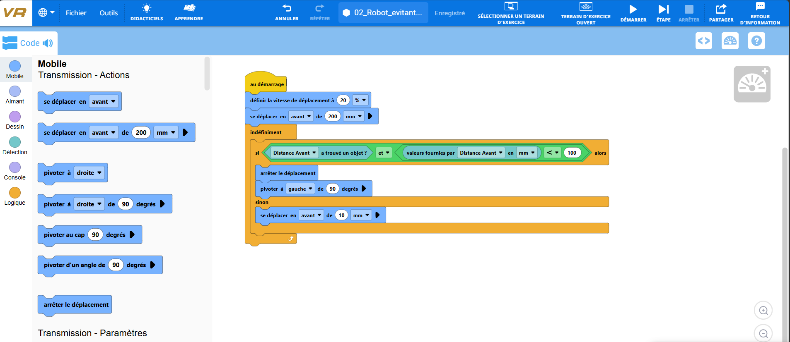
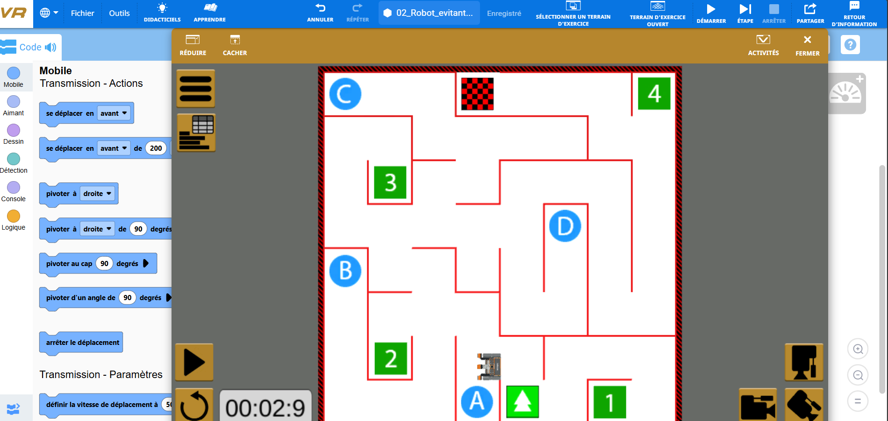

# Projet 02 — Robot évitant les obstacles

## 1. Présentation du projet

Ce projet a été réalisé dans le cadre du cours de Robotique et Intelligence Artificielle.

Il consiste à programmer un robot virtuel capable de détecter les obstacles présents sur son parcours et de modifier automatiquement sa trajectoire afin de les éviter.

La simulation a été réalisée sur la plateforme VEXcode VR, en utilisant le terrain « Wall Maze » (Labyrinthe de murs).

Ce terrain comporte plusieurs murs et passages qui permettent d'observer le comportement du robot lorsqu'il rencontre des obstacles.

## 2. Objectif du projet

L'objectif principal est de programmer un robot capable de se déplacer de manière autonome tout en réagissant aux obstacles présents dans son environnement.

Le robot doit pouvoir :

- Avancer automatiquement sur le terrain.
- Détecter les obstacles à l'aide de son capteur de distance.
- S'arrêter lorsqu'un obstacle se trouve à proximité.
- Modifier sa direction pour éviter une collision.
- Reprendre son déplacement lorsque le passage devant lui est dégagé.

Ce projet permet de mettre en pratique les notions de détection, de conditions logiques et de navigation autonome.

## 3. Outils et composants utilisés

### Plateforme
- VEXcode VR

### Environnement de simulation
- Wall Maze (Labyrinthe de murs)

### Robot virtuel
- Robot VR équipé de moteurs de déplacement.

### Capteur
- Capteur de distance avant (Distance Avant).

### Blocs de programmation utilisés
- Au démarrage
- Définir la vitesse de déplacement
- Se déplacer en avant
- Arrêter le déplacement
- Pivoter à gauche
- Indéfiniment
- Si / Sinon
- Opérateur logique ET
- Opérateur de comparaison inférieur à (<)
- Distance Avant a trouvé un objet ?
- Valeurs fournies par Distance Avant en mm

## 4. Fonctionnement du programme

### 4.1. Initialisation du robot

Au démarrage, la vitesse de déplacement du robot est définie à 20 %.

Le programme prévoit ensuite un premier déplacement vers l'avant de 200 mm.

Ce déplacement initial permet au robot de commencer sa progression sur le terrain avant d'exécuter les instructions de détection.

### 4.2. Détection des obstacles

Le robot utilise son capteur de distance avant pour vérifier la présence d'un obstacle devant lui.

La condition principale du programme repose sur deux vérifications :

1. Le capteur de distance doit détecter un objet.
2. La distance mesurée doit être inférieure à 100 mm.

Ces deux conditions sont associées à l'aide de l'opérateur logique « ET ».

Lorsque les deux conditions sont remplies, le robot considère qu'un obstacle se trouve suffisamment près pour déclencher une manœuvre d'évitement.

### 4.3. Évitement des obstacles

Lorsqu'un obstacle est détecté à moins de 100 mm, le robot exécute deux instructions :

1. Il arrête son déplacement.
2. Il pivote de 90 degrés vers la gauche.

Cette rotation permet au robot de modifier son orientation afin de rechercher une autre direction.

Après le pivotement, le programme reprend la vérification de la distance devant le robot.

Si aucun obstacle proche n'est détecté dans cette nouvelle direction, le robot peut poursuivre son déplacement.

### 4.4. Déplacement en l'absence d'obstacle

Lorsque la condition de détection n'est pas remplie, le robot avance de 10 mm.

Le choix d'un déplacement par petites distances permet de vérifier régulièrement la présence d'obstacles.

Le robot progresse ainsi progressivement tout en adaptant son orientation lorsqu'un mur est détecté.

### 4.5. Répétition des instructions

Les instructions de détection et de déplacement sont placées dans une boucle « Indéfiniment ».

Cette boucle permet au robot de répéter automatiquement les opérations suivantes :

1. Vérifier la présence d'un obstacle.
2. Mesurer la distance devant lui.
3. S'arrêter et tourner à gauche si un obstacle est trop proche.
4. Avancer lorsque la condition de détection n'est pas remplie.

Ce fonctionnement permet au robot de réagir à son environnement sans intervention manuelle pendant la simulation.

## 5. Tests et ajustements réalisés

Plusieurs simulations ont été effectuées pour observer le comportement du robot sur le terrain.

Les premiers essais ont montré certaines difficultés, notamment lorsque le robot se retrouvait près d'un mur ou dans un passage étroit.

Différentes modifications ont été testées pour améliorer son déplacement :

- Ajustement de la vitesse de déplacement.
- Modification du seuil de détection des obstacles.
- Réduction de la distance parcourue à chaque déplacement.
- Essais de rotations vers la droite et vers la gauche.
- Essais de déplacements en arrière pour dégager le robot lorsqu'il se trouvait près d'un mur.

Ces essais ont permis de constater que certains paramètres pouvaient améliorer le comportement du robot dans une zone tout en provoquant des difficultés dans une autre.

La version finale conserve une stratégie simple : détecter un obstacle, s'arrêter, tourner à gauche et poursuivre le déplacement lorsque le passage le permet.

## 6. Résultats obtenus

Les simulations réalisées montrent que le robot est capable de détecter certains murs et de modifier automatiquement sa direction pour les éviter.

Au cours des essais, le robot a réussi à contourner plusieurs obstacles et à progresser dans différentes zones du labyrinthe.

Les captures d'écran permettent d'observer son déplacement ainsi que les changements de direction effectués pendant la simulation.

Cependant, certaines limites ont été constatées. Dans les passages étroits ou lorsque plusieurs murs se trouvent à proximité, le robot peut rencontrer des difficultés à trouver une direction dégagée.

Le programme ne garantit donc pas la traversée complète du labyrinthe.

Malgré ces limites, les résultats obtenus démontrent le fonctionnement d'un système élémentaire de détection et d'évitement d'obstacles à l'aide d'un capteur de distance.

## 7. Captures d'écran

### 7.1. Programme réalisé

La capture suivante présente les blocs utilisés pour programmer le déplacement et la détection des obstacles.

### 7.2. Position initiale

Cette capture montre le robot au début de la simulation sur le terrain Wall Maze.

### 7.3. Évitement d'un obstacle

Cette capture illustre le changement de direction du robot lorsqu'il rencontre un obstacle.

### 7.4. Progression dans le labyrinthe

Cette capture présente la progression du robot après plusieurs déplacements et changements de direction.

## 8. Conclusion

Ce projet a permis de mettre en pratique les principes fondamentaux de la navigation autonome d'un robot virtuel.

Grâce à l'utilisation d'un capteur de distance, de conditions logiques et d'une boucle de répétition, le robot peut détecter la présence d'obstacles et adapter automatiquement sa direction.

Les différentes simulations ont également permis de comprendre l'importance du choix des paramètres de déplacement, notamment la vitesse, la distance de détection et l'angle de rotation.

Même si le programme présente certaines limites dans les passages complexes, il permet de démontrer le principe de l'évitement automatique des obstacles.

Ce travail constitue une première expérience pratique de programmation d'un robot capable de réagir aux informations fournies par son environnement.