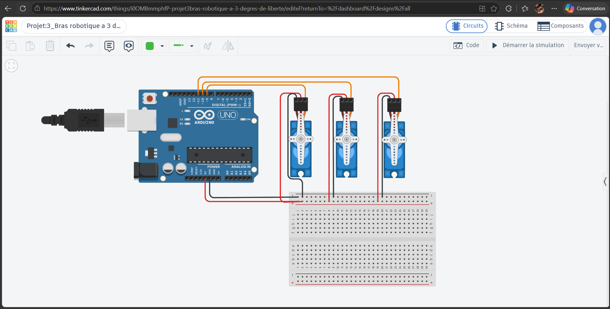
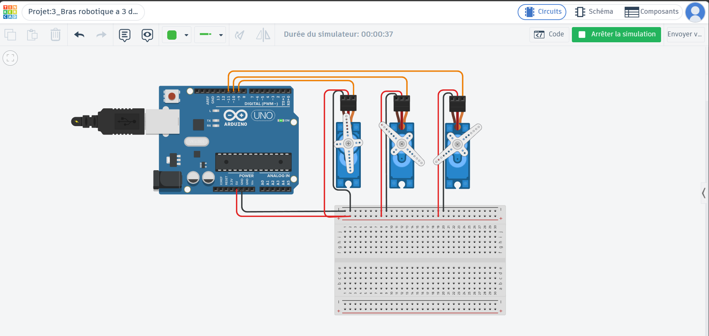
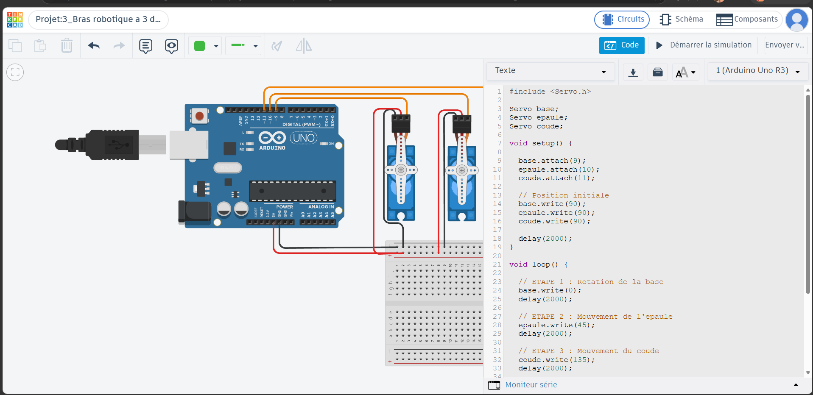

# Devoir n°3 — Bras robotique à 3 degrés de liberté

## 1. Objectif du projet

Ce projet consiste à simuler le fonctionnement d'un bras robotique
à trois degrés de liberté à l'aide d'une carte Arduino Uno et de
trois servomoteurs sur la plateforme Tinkercad.

L'objectif est de programmer une séquence de mouvements permettant
aux différentes articulations du bras d'atteindre des positions
angulaires précises.

## 2. Composants utilisés

- 1 carte Arduino Uno R3
- 3 servomoteurs
- 1 plaque d'essai (breadboard)
- Des fils de connexion

Plateforme de simulation : Tinkercad Circuits.

## 3. Montage du circuit

Les trois servomoteurs sont connectés à l'Arduino Uno.

Chaque servomoteur possède trois connexions :

- Terre (GND) : reliée au rail négatif de la plaque.
- Alimentation (5V) : reliée au rail positif de la plaque.
- Signal : relié à une broche numérique de l'Arduino.

Les connexions des signaux sont les suivantes :

- Servomoteur de la base : D9
- Servomoteur de l'épaule : D10
- Servomoteur du coude : D11

Les trois servomoteurs partagent une alimentation
commune de 5V et une masse commune.

### Capture du circuit

## 4. Degrés de liberté et rôle des servomoteurs

Le système possède trois degrés de liberté en rotation.

Chaque servomoteur représente une articulation indépendante
du bras robotique.

### Servomoteur 1 — Base

Le premier servomoteur représente la base du bras.

Il permet de simuler la rotation du bras vers différentes
directions.

Dans le programme, il passe de 90° à 0°, puis revient à 90°.

### Servomoteur 2 — Épaule

Le deuxième servomoteur représente l'articulation
de l'épaule.

Il permet de simuler le mouvement vertical du bras.

Dans le programme, il passe de 90° à 45°, puis revient à 90°.

### Servomoteur 3 — Coude

Le troisième servomoteur représente l'articulation
du coude.

Il permet de simuler le pliage et le dépliage du bras.

Dans le programme, il passe de 90° à 135°, puis revient à 90°.

## 5. Fonctionnement du programme

Le programme utilise la bibliothèque Servo.h pour
commander les trois servomoteurs.

Au démarrage, les trois servomoteurs sont placés
à une position initiale de 90°.

La séquence se déroule ensuite de la manière suivante :

1. La base tourne de 90° à 0°.
2. L'épaule passe de 90° à 45°.
3. Le coude passe de 90° à 135°.
4. Le coude revient à 90°.
5. L'épaule revient à 90°.
6. La base revient à 90°.

Des temporisations sont utilisées entre les commandes
pour permettre d'observer les mouvements successifs.

La séquence se répète automatiquement.

## 6. Résultats obtenus

La simulation a permis de vérifier le fonctionnement
des trois servomoteurs.

Chaque servomoteur atteint les positions angulaires
définies dans le programme.

Les mouvements sont exécutés successivement,
ce qui permet de distinguer le rôle de chaque articulation.

Le système revient ensuite à sa position initiale
avant de recommencer la séquence.

### Capture de la simulation

### Capture du programme Arduino

## 7. Conclusion

Ce projet a permis de comprendre comment une carte
Arduino peut commander plusieurs servomoteurs
pour reproduire les mouvements d'un bras robotique.

L'utilisation de trois servomoteurs permet de représenter
trois degrés de liberté indépendants.

La simulation démontre le contrôle des positions
angulaires des articulations.

Le montage constitue une représentation électronique
du fonctionnement d'un bras robotique, sans assemblage
mécanique des différentes articulations.

## 8. Lien de la simulation Tinkercad

[Lien vers le projet Tinkercad](https://www.tinkercad.com/things/i0OMBmmphfP-projet3bras-robotique-a-3-degres-de-liberte?sharecode=DIeQxoPq-Lyqj3ExCVA8EtTmVwTQAzX_zhGXZIP1Snw)