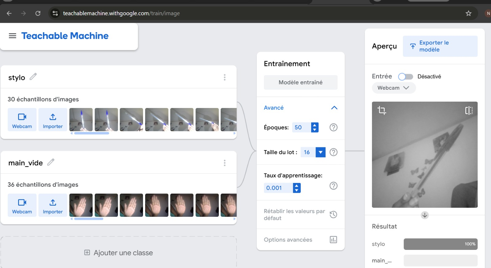
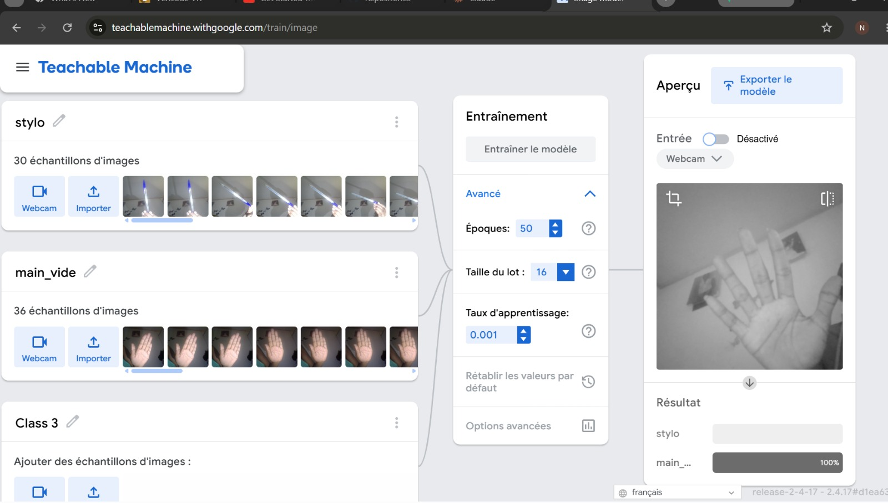

# Devoir n°4 — Classificateur d'images simple

## 1. Objectif du projet

L'objectif de ce projet est de créer un modèle simple
d'intelligence artificielle capable de reconnaître deux
catégories d'images à partir d'une webcam.

Le modèle doit distinguer un stylo d'une main vide
en analysant les images présentées devant la caméra.

## 2. Outils utilisés

- Google Teachable Machine
- Webcam
- Navigateur web
- Ordinateur

## 3. Réalisation du projet

Le projet a été réalisé sur Google Teachable Machine
en utilisant la fonctionnalité Image Project.

Deux classes ont été créées :

- Classe 1 : stylo
- Classe 2 : main_vide

Pour entraîner le modèle, 30 images de stylo et
36 images de main vide ont été enregistrées
à l'aide de la webcam.

Les images ont été prises dans différentes positions
afin de fournir plusieurs exemples au modèle.

Après la collecte des images, le modèle a été entraîné
avec les paramètres suivants :

- Époques : 50
- Taille du lot : 16
- Taux d'apprentissage : 0.001

## 4. Fonctionnement du modèle

Le modèle utilise l'apprentissage supervisé.

Pendant l'entraînement, il analyse les images
associées à chaque classe et ajuste progressivement
ses paramètres pour apprendre à distinguer
les caractéristiques visuelles des deux catégories.

Une fois entraîné, il reçoit les images de la webcam
et calcule une probabilité pour chaque classe.

La classe ayant la probabilité la plus élevée
correspond à la prédiction du modèle.

## 5. Résultats obtenus

Les tests réalisés avec la webcam ont permis
d'obtenir les résultats suivants :

- Reconnaissance du stylo : 100 %
- Reconnaissance de la main vide : 100 %

Ces résultats correspondent aux prédictions affichées
pendant les tests. Ils ne constituent pas une mesure
de précision globale du modèle.

### Reconnaissance du stylo

### Reconnaissance de la main vide

## 6. Explication de l'entraînement

Pendant l'entraînement, le modèle a utilisé les images
enregistrées pour apprendre à différencier un stylo
d'une main vide.

À chaque époque, ses paramètres ont été ajustés
afin de réduire les erreurs de classification.

Après l'entraînement, le modèle a été testé
directement avec la webcam sur de nouvelles images.

Les résultats montrent qu'il parvient à reconnaître
les deux catégories dans les conditions du test.

## 7. Conclusion

Ce projet a permis de comprendre les principales
étapes de création d'un classificateur d'images :
la collecte des données, l'entraînement du modèle
et la vérification des prédictions.

L'expérience montre comment un modèle
d'intelligence artificielle peut apprendre
à distinguer des objets à partir d'exemples visuels.

Cependant, les résultats peuvent varier selon
l'éclairage, la position des objets et les images
utilisées pendant l'entraînement.