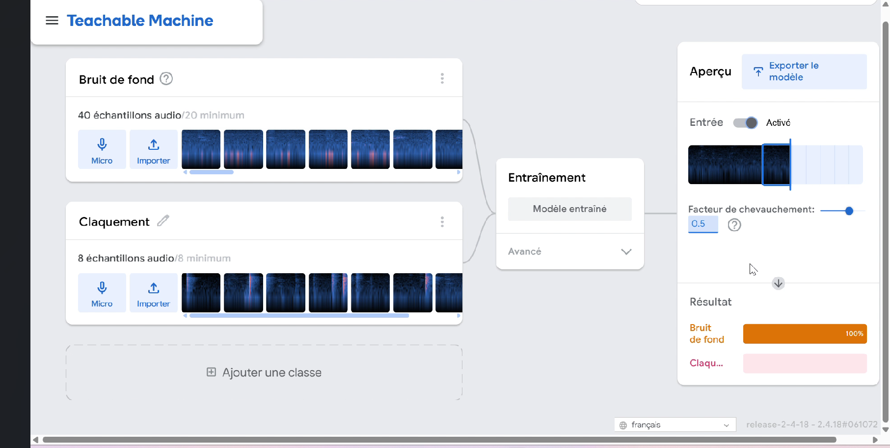
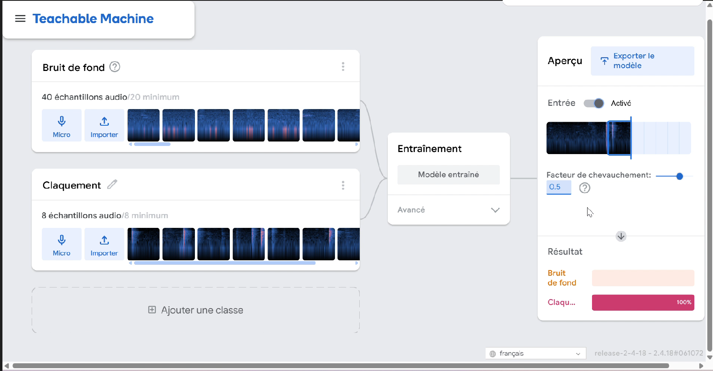

# Devoir n°5 — Classificateur de sons

## 1. Objectif du projet

L'objectif de ce projet est de créer un modèle simple
d'intelligence artificielle capable de reconnaître
différentes catégories de sons à partir d'un microphone.

Le modèle doit distinguer un claquement de mains
du bruit de fond en analysant les sons enregistrés.

## 2. Outils utilisés

- Google Teachable Machine
- Microphone
- Ordinateur
- Navigateur web

## 3. Réalisation du projet

Le projet a été réalisé sur Google Teachable Machine
en utilisant la fonctionnalité Audio Project.

Deux classes ont été utilisées :

- Classe 1 : Bruit de fond
- Classe 2 : Claquement

Pour constituer les données d'entraînement,
40 échantillons audio ont été enregistrés
pour la classe Bruit de fond et 8 échantillons
pour la classe Claquement.

Après l'enregistrement des échantillons,
le modèle a été entraîné afin d'apprendre
à différencier les deux catégories de sons.

## 4. Fonctionnement du modèle

Le système repose sur l'apprentissage supervisé.

Pendant l'entraînement, le modèle analyse
les caractéristiques des échantillons audio
associés à chaque classe.

Il apprend progressivement à reconnaître
les différences entre les sons enregistrés.

Une fois entraîné, il utilise le microphone
pour analyser les sons captés en temps réel.

Le modèle attribue un score de confiance
à chaque classe et affiche la catégorie
correspondant au score le plus élevé.

## 5. Résultats obtenus

Les tests réalisés après l'entraînement
ont montré que le modèle pouvait reconnaître
les deux catégories de sons.

Les résultats observés sont les suivants :

- Bruit de fond : 100 %
- Claquement : 100 %

Ces pourcentages représentent les scores
de confiance affichés lors des tests.
Ils ne constituent pas une mesure de
précision globale du modèle.

### Reconnaissance du bruit de fond

### Reconnaissance du claquement

## 6. Comparaison avec le devoir n°4

Les deux projets reposent sur le même principe
d'apprentissage supervisé.

Dans les deux cas, des exemples sont collectés,
organisés en classes et utilisés pour entraîner
un modèle d'intelligence artificielle.

La principale différence concerne la nature
des données analysées.

Dans le devoir n°4, le modèle utilise
des images provenant de la webcam
pour distinguer un stylo d'une main vide.

Dans le devoir n°5, le modèle utilise
des enregistrements audio provenant
du microphone pour distinguer un claquement
de mains du bruit de fond.

Le classificateur d'images apprend à reconnaître
des caractéristiques visuelles, tandis que
le classificateur de sons apprend à reconnaître
des caractéristiques acoustiques.

Les deux modèles peuvent effectuer
des prédictions en temps réel après leur entraînement.

## 7. Conclusion

Ce projet a permis de comprendre comment
un modèle d'intelligence artificielle peut
être entraîné à reconnaître différentes
catégories de sons.

L'expérience a montré l'importance
de la collecte des échantillons audio,
de leur classification et de l'entraînement
du modèle.

La comparaison avec le classificateur d'images
montre que les principes de l'apprentissage
supervisé peuvent être appliqués
à différents types de données.

Cependant, la qualité des prédictions
peut varier selon le bruit ambiant,
la qualité du microphone et les exemples
utilisés pendant l'entraînement.